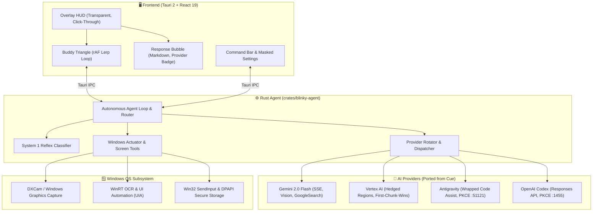

# Clinky 🤖

> **General-Purpose Windows AI Buddy** · Sits by the cursor · Perceives the screen · Hears & talks back · Acts safely on Windows

<br>


-blue)


---

## What is Clinky?

Clinky is a general-purpose Windows AI buddy that sits unobtrusively beside your cursor, sees what is on your screen, listens to your voice, speaks responses, and can safely perform desktop actions.

Unlike rigid tutors that force step-by-step software walkthroughs for every prompt, Clinky is an **omni-assistant**:
- **Coding & Technical Questions**: Get direct, formatted code and explanations with copy buttons.
- **General Knowledge & Philosophy**: Receive direct answers immediately.
- **Homework & Visual Material**: Understand diagrams, math formulas, and articles visible on your screen.
- **Software Help & Grounded Guidance**: Opt-in visual bounding boxes and highlights on actual UI elements when you need assistance finding controls.
- **Safe Laptop Actions**: Bounded computer-use automation with interactive human-in-the-loop safety confirmation gates.

---

## Key Features

| Capability | How It Works |
|---|---|
| **Buddy Cursor** | Clicky-inspired glowing cyan/blue solid triangle (`#8EC5FF`) floating discreetly beside the native cursor (+14px, -16px) with smooth `requestAnimationFrame` easing and idle breathing. |
| **Floating Response Bubble** | Appears near the buddy when Clinky answers. Features markdown rendering, provider/model badge, copy button, dismiss button, and an auto-hide timer paused on hover. |
| **Click-Through Transparency** | The full-screen overlay passes all clicks through to underlying Windows applications (`setIgnoreCursorEvents(true)`) by default, automatically enabling pointer events only when you hover interactive cards. |
| **Multi-Provider AI Engine** | Ported high-performance providers from Cue: **Gemini 2.0 Flash** (streaming, multimodal vision, Google Search grounding), **Vertex AI** (hedged parallel regions, first chunk wins, 20s deadline), **Antigravity** (Google Cloud Code Assist wrapped PKCE loopback on port 51121), **OpenAI Codex** (Responses API with token rotation on port 1455), **Groq**, and **Ollama**. |
| **Screen Perception** | Ultra-low latency DXCam screen capture, Windows Media OCR, and UI Automation (UIA) tree extraction with logical/physical DPI scaling. Gracefully falls back to text OCR when DRM or `WDA_EXCLUDEFROMCAPTURE` blanks pixel frames. |
| **Safety Confirmation Gates** | State-changing or destructive laptop actions (file modifications, shell commands, settings changes) require interactive user approval. General status queries ("Are there pending actions?") answer with "Nothing awaiting confirmation." |
| **No Docker Required** | Seamless local development workflow (`bun run dev:no-docker`). Google Search grounding replaces heavy local SearXNG containers by default. |

---

## Quick Start on Windows

### 1. Prerequisites
- **Windows 10 / 11** (64-bit)
- **Bun 1.3+** (`irm bun.sh/install.ps1 | iex`)
- **Rust stable (MSVC)** (`rustup default stable-x86_64-pc-windows-msvc`)
- **Python 3.11 or 3.12**
- **WebView2 Runtime** (installed by default on Windows 10/11)

### 2. Setup
From a clean checkout:

```powershell
# Run the automated Windows setup script
powershell -ExecutionPolicy Bypass -File setup.ps1
```

This installs Bun node dependencies, creates the Python virtual environment (`.venv`), installs Windows screen capture & OCR packages, and generates your `.env`.

### 3. Configure Your Provider Key
Add your preferred AI provider key to `.env` or open Settings in Clinky:

```env
# Gemini (Default provider)
GEMINI_API_KEY=AIzaSy...

# Or Vertex AI
VERTEX_PROJECT_ID=my-gcp-project
GOOGLE_APPLICATION_CREDENTIALS=C:\path\to\service-account.json

# Or OpenAI / Codex
OPENAI_API_KEY=sk-...

# Or Groq
GROQ_API_KEY=gsk_...
```

### 4. Launch Clinky
Start Clinky without Docker:

```powershell
powershell -ExecutionPolicy Bypass -File run.ps1
# Or directly via Bun:
bun run dev:no-docker
```

---

## Hotkeys & Controls

| Shortcut / Trigger | Action |
|---|---|
| `Alt + Space` / `Ctrl + Shift + Space` | Toggle Clinky Command Bar |
| `Escape` | Dismiss active response bubble or close command panel |
| `Hey Clinky` / `Hey Blinky` | Hands-free local wake-word trigger |
| Tray Icon Click | Show / hide Clinky Command Bar & Settings |

---

## Architecture Overview



---

## Detailed Documentation
- [`BUILD_NOTES.md`](BUILD_NOTES.md) - Changes from Blinky, ported Cue behaviors, Clicky sampled values, OAuth endpoints, and verification checklist.
- [`ANALYSIS.md`](ANALYSIS.md) - Codebase audit and gap analysis between Linux and Windows.
- [`RESEARCH.md`](RESEARCH.md) - Authoritative Windows citations for DXCam, WGC, WinRT OCR, UIA coordinates, and Tauri overlays.

---

## License
MIT License.
